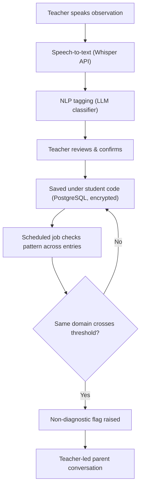

# Every Child Should Be Seen

### An AI-Assisted Early Childhood Development & Support System

---

## 1. The Problem

A child who struggles with transitions, following instructions, or group activities is often labelled "difficult" or "lazy" instead of understood. The observation that could reveal a real pattern is usually written on paper, kept by one teacher, and lost the moment the child changes teacher or grade. By the time anyone notices a pattern, years have passed.

## 2. Our Solution, in One Paragraph

Trained teachers speak a short observation after class. Speech-to-text and NLP convert it into a structured developmental record — filed under the child's private code, never their name. The record follows the child from Nursery through the higher grades. When a concern recurs across entries, the system raises a neutral, non-diagnostic flag for the teacher, who then leads a trend-based conversation with the parents. No score is ever public, no name is ever stored against a behavioural record, and no diagnosis is ever made by the system.

---

## 3. How We Compare to Existing Technology

| Existing Technology | Feature | Limitation | What We Overcome | How We Overcome It (Technology) |
| --- | --- | --- | --- | --- |
| TeachScribe | Voice-to-text linked to curriculum/EYFS goals | Tracks learning progress, not behavioural or developmental concerns | Capture developmental and behavioural domains, not just curriculum milestones | Whisper (speech-to-text) → LLM/NLP classifier tags transitions, emotional regulation, attention, and social participation |
| illumine | AI-assisted daily reports, lesson planning, compliance flags | Each note stands alone; recurring patterns across years go undetected | Surface recurring concerns across multiple years | PostgreSQL stores tagged history; a scheduled backend job checks when a domain crosses a defined threshold |
| CuePilot | Voice note → structured report-card draft | Built around individual report cycles; continuity breaks when a child moves grades | Maintain one continuous student record | A permanent student code is carried forward at every grade promotion |
| Evidence Me | Photo/video capture with face-blurring | A media log, not structured developmental data | Convert observations into structured, searchable data | Speech-to-text + NLP tagging extracts domain tags and searchable text instead of storing raw media |
| ClassDojo | Public behavioural points and scores | Public scoring can create labels or stigma that follow a child for years | Remove public scores, rankings, and labels entirely | Output is a neutral, staff-only sentence such as "repeated difficulty with transitions" — never a score |
| ClassDojo | Behaviour logging | Families may not have given informed agreement before data collection | Obtain consent before any observation is recorded | Written parent/guardian consent collected at school admission |
| ClassDojo | Names and behavioural information stored together | A breach directly links an identity to sensitive behavioural history | Separate identity from behavioural records | The name is converted into a unique student code; every observation afterward references only the code |
| ClassDojo / general SaaS | Centralised database, standard access | Broad staff or vendor access increases privacy exposure | Restrict access to authorised staff only | AES-256 encryption at rest, TLS in transit, and role-based access control (teacher, counsellor, principal only) |
| ClassDojo | Deletes behavioural data after ~1 year | Solves privacy, but destroys the multi-year pattern the idea depends on | Preserve longitudinal history safely | Records stay code-based, encrypted, and access-controlled, so long retention doesn't mean unsafe retention |
| Teachscape / Sibme | Observes and scores the teacher | Evaluates adults, not child development — wrong subject | Keep the system's whole focus on the child's developmental trajectory | Every record is schema-locked to a child's code and a developmental domain, never a teacher's name |
| Paper diaries / manual system | Handwritten teacher observations | Records are fragmented, illegible, or lost between teachers and grades | Create one centralised, searchable record | Voice input → transcription → NLP tagging → one shared database every teacher reads from |

**The one idea that ties every row together:** existing tools either expose the child (public scores, names tied to records) or forget the child (single-cycle reports, short data retention). This system is built to privately remember the child — the code exists specifically so the history isn't lost, without recreating the exposure that got tools like ClassDojo criticized.

---

## 4. System Architecture

```mermaid
flowchart LR
    subgraph AI["AI Features"]
        STT["Speech-to-Text"]
        NLP["NLP Tagging"]
        PAT["Pattern Detection"]
    end

    subgraph USERS["Users"]
        T["Teacher"]
        AD["Admin"]
        P["Parent (view only)"]
    end

    subgraph WEB["Web Application"]
        UI["User Interface"]
        AUTH["Authentication & Authorization"]
        ROLE["Role-Based Portals"]
    end

    subgraph BACK["Backend Services"]
        OBS["Observation Management"]
        ROST["Roster Management"]
        FLAG["Pattern & Flag Engine"]
        REP["Report Generation"]
    end

    subgraph DB["PostgreSQL Database"]
        OD["Observation Data"]
        SC["Student Codes"]
        DT["Domain Tags"]
    end

    AI --> USERS --> WEB --> BACK --> DB
    DB -.->|"feeds patterns back"| AI
```

**Reading the diagram:** a teacher (Users) speaks into the Web Application, which authenticates them and routes them to their portal. The Backend Services log the observation, and the AI Features (speech-to-text, NLP tagging, pattern detection) turn it into a structured, coded record in the database. The database's accumulated history is what feeds pattern detection on every new entry — that feedback loop is the entire point of the system.

---

## 5. Observation Workflow, Start to Finish

Nothing about a specific child leaves the system without a teacher's confirmation — once at recording, and again before any parent conversation happens.

---

## 6. Privacy & Security Design

| Concern | Design Response |
| --- | --- |
| A name tied to sensitive behavioural data | Name used once to generate a code; all records afterward reference the code only |
| Unauthorised access to records | Role-based access — only the class teacher, counsellor, and principal can view a child's record |
| Data intercepted or leaked | AES-256 encryption at rest, TLS encryption in transit |
| Consent | Written parental consent obtained at school admission, before any observation is recorded |
| A record becoming a "permanent label" | Output is a neutral, descriptive sentence about a pattern — never a diagnosis, score, or public label |
| Voice recordings themselves | Audio is transcribed, then discarded — only the structured text and tags are kept |

---

## 7. Technology Stack

| Layer | Technology |
| --- | --- |
| Frontend | React or HTML/JS, with the Web Speech API for voice capture |
| Speech-to-text | Whisper API |
| Text structuring | LLM (GPT/Claude) prompt-based classifier, or a trained model once enough data exists |
| Backend | Node.js or Python (e.g. FastAPI) |
| Database | PostgreSQL, keyed by student code |
| Pattern detection | Scheduled backend job querying tagged history per student |
| Hosting/Auth | Role-based authentication and authorization at the API layer |

---

## 8. Scope

**In scope**

- One school, one shared developmental framework from Nursery to the higher grades
- Input only from trained early-education teachers, working in pairs (one teaching, one observing)
- Weekly, monthly, and notable-event observations — not daily logs
- Pattern surfacing, classroom-strategy suggestions, and progress monitoring
- Trend-based parent reports delivered through teacher-led counselling

**Out of scope**

- Diagnosis, or naming of medical or developmental conditions
- Sharing or linking records across different schools
- Direct, automated alerts to parents
- Replacing the judgement of teachers, special educators, or clinicians

.mermaid-diagram{margin-block:4px}.mermaid-diagram svg{display:block;margin:0 auto;max-width:100%;height:auto}

(function(){
var CFG={"palettes":{"light":{"surface":"#f4efe4","text":"#42392e","line":"#8a7f6d","border":"#7a6c52","bg":"#fffdf8"},"dark":{"surface":"#262b34","text":"#f2f3f5","line":"#a8adb8","border":"#9aa4b8","bg":"#1f232b"}}};
if(typeof mermaid==='undefined')return;
var pres=Array.prototype.slice.call(document.querySelectorAll('pre.mermaid')).filter(function(p){if(p.hasAttribute('data-claude-mermaid-claimed'))return false;p.setAttribute('data-claude-mermaid-claimed','1');return true;});
if(!pres.length)return;
var mq=window.matchMedia?window.matchMedia('(prefers-color-scheme: dark)'):null;
var root=document.documentElement;
var items=pres.map(function(pre){
var mount=document.createElement('div');mount.className='mermaid-diagram';
return {pre:pre,mount:mount,src:pre.textContent||''};
});
var seq=0;
var renderGen=0;
var lastKey='';
function pageBg(fallback){
var els=[document.body,document.documentElement];
for(var i=0;i
